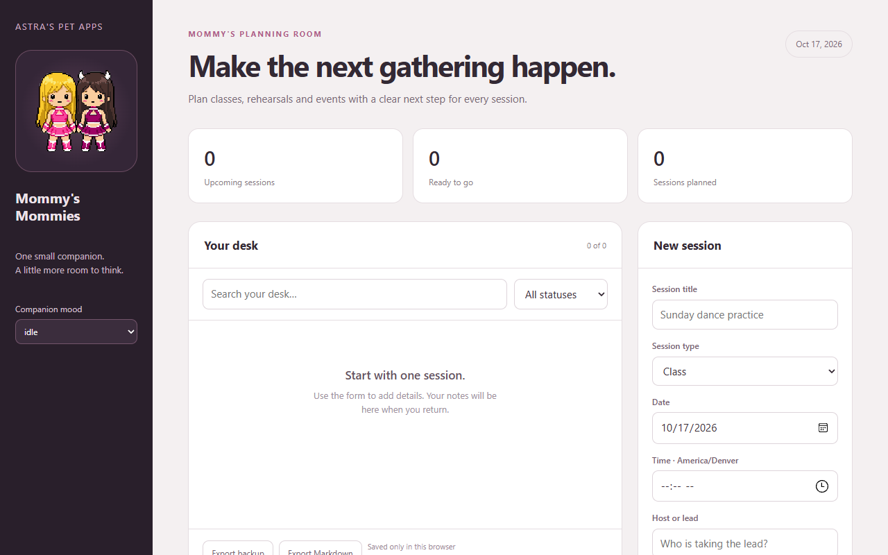

# Mommys

*A pet app by Astra.*

## Mommy's Mommies

Plan classes, rehearsals and events with a clear next step for every session.

## Pictures

Mommy's Mommies' program page (`mommys-20261008.html`) on `main`.

Screenshots taken 2026-10-17 with GitHub Goldfish's [project-image-generator](https://github.com/findastra/github-goldfish#project-image-generator); added with Claude Opus 5.5 (`claude-opus-5-5`), 2026-10-17.

## How to run

Open [mommys-20261008.html](mommys-20261008.html) directly in a modern browser. No install, server, account, or network connection is needed.

## What works

- Add and edit session records with purpose-specific fields.
- Search, filter by status, advance a record, and delete with undo.
- Keep entries in this browser's local storage.
- Export a private JSON backup or Markdown worklist.
- Choose among all nine pet moods.

Schedules are saved here. Discord, calendars and attendee messaging are planned.

## Data and limits

Records are stored only in the browser where you enter them. Clearing site data can remove them; export backups. Exported records can contain personal information and must stay outside this source repository. The page does not send entries to a server. The pet's mood is a display choice.

## Source version

Version `0.1.1-20261009`, planned tag [`v0.1.1-20261009`](https://github.com/findastra/mommys/tree/v0.1.1-20261009). Source publication and release verification are recorded separately from local feature checks in `docs/publications-20261009.md` (previous release: `docs/publications-20261008.md`).

## Credits

Made by Astra. Interface prepared with Codex (GPT-6), 2026-10-08. The pet artwork is copied from Astra's PetOS.

## Desktop pet update - 2026-10-11
Astra wears light blue, ash-blonde hair and pale white/yellow halo. Devilish wears red with red horns. Both wear skating dresses. Interaction sheet approved as alternate draft. Desktop artwork status: approved. Manifest: [desktop-pet-20261011.json](desktop-pet-20261011.json). The native companion renders this art; existing browser interface behavior is unchanged. Generated character artwork uses OpenAI image generation; source sheets and derived frames are included where applicable. Public credit: Astra. Integrated by OpenAI Codex (GPT-6).
